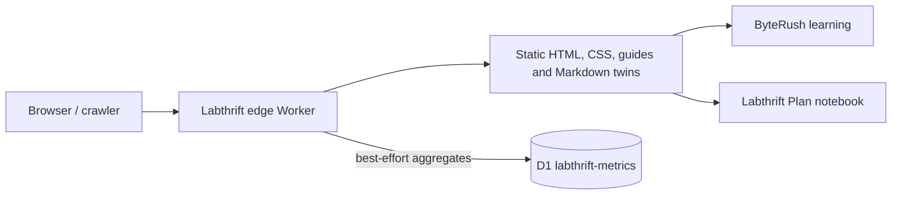

# Labthrift website — High-Level Design

> Baseline: 2026-10-03. Product: Labthrift website. Repository: `zemdregon/labthrift`. Source-grounded design baseline; deployment and acceptance evidence is tracked separately in [release status](release-status.md).

## Architecture

The static site is the product frontend. Its supporting backend is a small edge Worker, not a learner-account service. The Worker wraps asset serving with content negotiation, cache/security headers, crawler classification, discovery metadata and aggregate metrics. Public content is maintained in the repository.

## Deployment
Wrangler config names the Worker `labthrift`, binds assets and `METRICS`, and configures `labthrift.com` plus `www.labthrift.com`. The asset directory is currently the repository root, so publishing exclusions and blocked internal routes matter. Local preview may stage public files to avoid watching generated/dependency trees; this does not change production architecture.

## Product boundaries
ByteRush owns anonymous/account learning and all imported Runs projects. Plan owns notebooks and its own passkeys. The website links to both and remains the provenance/source guide destination. It does not issue their sessions or copy their data.

## Release considerations
Runs removal must not target the main Worker, custom domains or metrics D1. No redirect at beta is retained under the approved policy. If a source guide is missing, resolve the guide/link issue before claiming full content continuity. Historical design notes do not establish current deployment state; verify the configured live surfaces independently.
